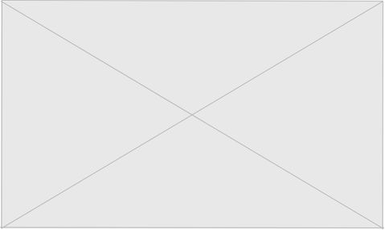

# architect-portfolio-tailwind
An Architect Portfolio Designed Using HTML, CSS, Tailwind and JS Vanilla

## Design & Features
### Design
This is a architectural porfolio website to promote the current ongoing and completed projects of an architectural firm. It uses HTML for structure with a combination of CSS and tailwind for styling and responsiveness to different screen sizes. It also uses javascript to control the links of the navbar, reducing them to a dropdown menu for smaller screen sizes. All projects on this website are models that have been fabricated for display purposes. 

This is also a completion of a piece of coursework for ITOL Tailwind CSS where a wireframe was provided and it was provided to replicate this as closely as possibly using HTML, CSS and tailwind. The use of absolute positiong was strictly not allowed. 

### Features
#### Navigational bar
Allows navigation between all three pages. This is fixed to the top of the webpage, making it always accessible, regardless of how far down you scroll. 

#### Home page 
This is where the website will initially navigate to, showing main articles and company statistics. Hovering ovr clickable items reduces their opacity, increases their size and changes the mouse icon to a pointer. Clicking on these items will allow the client to navigate to more indepth version of this article.

#### Projects
This is where your company can currently display it's ongoing and completed projects using the gallery system. Hovering over a gallery item changes the background color to grey. Hovering ovr clickable items reduces their opacity, increases their size and changes the mouse icon to a pointer. Clicking on these items will allow the client to navigate to more indepth version of this article.

#### Contact
Contact details for your company. This also has a contact form that will have the ability to send an email directly to a specified email address.  

### Footer
This contains company details and links to the company's social media. 

## File List
### Images 
Folder containing all images used in this project. All images are from unsplash.com and are free to use under the unsplash license. Credit to the image creators is in the HTML but is not rendered on the webpage to provide a more consistent layout. 

#### index.html
Homepage HTML. 

#### contact.html
Contact page.

#### projects.html
Project page. 

#### styles.css
Styling sheet for controlling: 
    - general styles
    - button and link animations
    - navbar styles and responsiveness 
    - statistics container styles and responsiveness on the home page
    - current projects gallery styles and responsiveness on the projects page
    - repetitive elements on the contact page, namely the smaller titles (named subtitles container in the class atribute) and the direct reach section. 